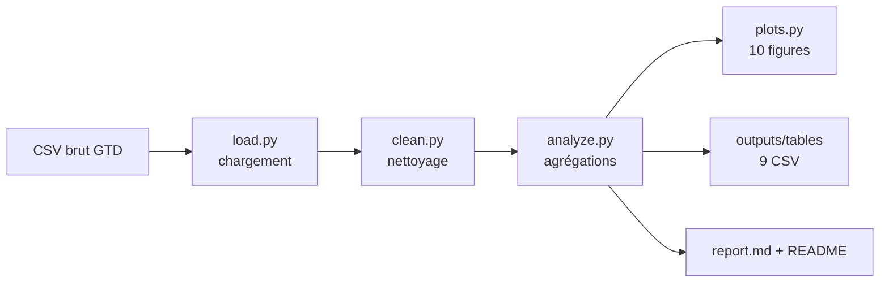

# 🌍 Analyse de la Global Terrorism Database (GTD)

   

Pipeline Python d'analyse exploratoire de la **Global Terrorism Database** (START, Université du Maryland) : plus de 180 000 attentats recensés dans le monde depuis 1970. Le projet répond à quatre questions : **où, quand, comment et par qui** les attentats sont commis, et **quelle est leur létalité**.

## Sommaire
1. [Objectifs](#-objectifs)
2. [Données](#-données)
3. [Architecture du pipeline](#-architecture-du-pipeline)
4. [Méthodologie](#-méthodologie)
5. [Installation et utilisation](#-installation-et-utilisation)
6. [Résultats principaux](#-résultats-principaux)
7. [Guide de lecture des figures](#-guide-de-lecture-des-figures)
8. [Limites](#-limites)
9. [Pistes d'amélioration](#-pistes-damélioration)
10. [Source et licence](#-source-et-licence)

## 🎯 Objectifs
- **Quand** : comment le nombre d'attentats et de morts évolue-t-il par année et par décennie ? Existe-t-il une saisonnalité ?
- **Où** : quelles régions et quels pays sont les plus touchés ? Comment la géographie a-t-elle changé ?
- **Comment** : quels types d'attaque, d'armes et de cibles dominent ? Lesquels sont les plus meurtriers ?
- **Par qui** : quels groupes sont les plus actifs ? Quelle part des attentats n'est pas revendiquée ?
- **Évolution des méthodes** : place des attentats-suicides dans le temps.

## 📦 Données
| Élément | Détail |
|---|---|
| Source | START – National Consortium for the Study of Terrorism and Responses to Terrorism |
| Fichier attendu | `data/raw/globalterrorismdb_0718dist.csv` (encodage latin-1) |
| Volume | ~180 000 lignes, 135 colonnes (21 utilisées ici) |
| Téléchargement | https://www.start.umd.edu/gtd/ ou Kaggle (voir `data/README.md`) |

### Variables utilisées
| Colonne GTD | Nom après nettoyage | Description |
|---|---|---|
| `eventid` | `eventid` | Identifiant unique de l'événement |
| `iyear`, `imonth`, `iday` | `year`, `month`, `day` | Date (0 = inconnu → NaN) |
| `country_txt`, `region_txt` | `country`, `region` | Localisation |
| `provstate`, `city`, `latitude`, `longitude` | idem | Localisation fine |
| `success` | `success` | Attaque réussie (1) ou non (0) |
| `suicide` | `suicide` | Attentat-suicide (1) ou non (0) |
| `attacktype1_txt` | `attack_type` | Type d'attaque |
| `targtype1_txt` | `target_type` | Type de cible |
| `weaptype1_txt` | `weapon_type` | Type d'arme |
| `gname` | `group` | Groupe auteur |
| `nkill`, `nwound` | `nkill`, `nwound` | Morts, blessés |

### Variables dérivées
`casualties` (morts + blessés), `decade`, `deadly` (au moins un mort), `is_unknown_group`, `casualties_known`.

## 🧱 Architecture du pipeline


```
gtd-analysis/
├── main.py                 # orchestre tout le pipeline
├── requirements.txt
├── src/gtd/
│   ├── load.py             # lecture du CSV
│   ├── clean.py            # nettoyage + variables dérivées
│   ├── analyze.py          # tables d'analyse
│   └── plots.py            # visualisations
├── data/
│   ├── raw/                # CSV GTD (ignoré par git)
│   └── processed/          # données nettoyées (généré, ignoré par git)
└── outputs/
    ├── figures/            # PNG
    ├── tables/             # CSV
    └── report.md           # rapport généré
```

## 🔬 Méthodologie
1. **Chargement** : seules les colonnes utiles sont lues (rapide, peu de mémoire).
2. **Doublons** : suppression sur `eventid`.
3. **Dates** : mois ou jour à 0 remplacés par NaN (la saisonnalité n'utilise que les mois connus).
4. **Victimes** : valeurs manquantes traitées comme 0 pour les totaux ; un indicateur `casualties_known` conserve l'information.
5. **Coordonnées** : latitudes hors [-90, 90] et longitudes hors [-180, 180] mises à NaN.
6. **Groupes** : valeurs manquantes → `Unknown`, exclus des classements de groupes.
7. **Indicateurs** : attentats, morts, blessés, taux de succès, morts par attentat (létalité), part d'attentats-suicides.

## ⚙️ Installation et utilisation
```bash
git clone <votre-repo> && cd gtd-analysis
python -m venv .venv && source .venv/bin/activate   # Windows : .venv\Scripts\activate
pip install -r requirements.txt

# Placer la GTD dans data/raw/ (voir data/README.md), puis :
python main.py --data data/raw/globalterrorismdb_0718dist.csv
```
| Option | Défaut | Rôle |
|---|---|---|
| `--data` | `data/raw/globalterrorismdb_0718dist.csv` | Chemin du CSV |
| `--out` | `outputs` | Dossier de sortie |

Sorties : `outputs/figures/*.png`, `outputs/tables/*.csv`, `outputs/report.md`, et la section **Résultats principaux** ci-dessous.

> 💡 Pour que les images s'affichent sur GitHub, versionnez le dossier `outputs/` après avoir lancé le script.

## 📊 Résultats principaux
<!-- RESULTS:START -->
*Cette section est générée automatiquement : lancez `python main.py` avec la GTD dans `data/raw/` pour y afficher les chiffres clés, les classements et les 10 figures.*
<!-- RESULTS:END -->

## 🖼️ Guide de lecture des figures
| Figure | Ce qu'elle montre | À regarder |
|---|---|---|
| `01_evolution_annuelle` | Attentats (courbe pleine) et morts (pointillés) par année | Les pics et la rupture récente |
| `02_regions` | Attentats par région | Les régions dominantes |
| `03_top_pays` | 15 pays les plus touchés | Concentration géographique |
| `04_attaques_armes` | Types d'attaque et d'armes | Poids des explosifs et armes à feu |
| `05_heatmap_region_decennie` | Région × décennie | Déplacement du centre de gravité |
| `06_top_groupes` | Groupes les plus actifs (hors Unknown) | Groupes dominants |
| `07_letalite_type_attaque` | Morts par attentat selon le type | Types les plus meurtriers |
| `08_saisonnalite` | Attentats par mois | Variations saisonnières |
| `09_attentats_suicides` | Attentats-suicides par année | Montée de cette tactique |
| `10_carte_attentats` | Localisation (longitude/latitude) | Zones de concentration |

Tables CSV : `overview`, `by_year`, `region_by_decade`, `top_countries`, `top_regions`, `top_groups`, `top_attack_types`, `top_target_types`, `top_weapon_types`.

## ⚠️ Limites
- Victimes inconnues comptées comme 0 : morts et blessés sont des **minorants**.
- Les données de **1993** sont absentes de la GTD (creux artificiel dans les séries).
- Les tendances reflètent aussi l'évolution de la **collecte** des données, pas seulement celle des faits.
- Beaucoup d'attentats ont un **auteur inconnu** : les classements de groupes sont partiels.
- Seule la première valeur de type d'attaque, d'arme et de cible est utilisée (`*1_txt`).

## 🚀 Pistes d'amélioration
- Carte interactive (Plotly / Folium) et carte choroplèthe par pays.
- Analyse des attaques multiples (`attacktype2/3`, `weaptype2/3`).
- Modèle prédictif de la létalité d'un attentat (régression / arbres).
- Tableau de bord Streamlit.
- Tests unitaires (`pytest`) pour le nettoyage.

## 📚 Source et licence
National Consortium for the Study of Terrorism and Responses to Terrorism (START), *Global Terrorism Database*. https://www.start.umd.edu/gtd — les données restent soumises à la licence START et ne sont pas redistribuées dans ce dépôt.
